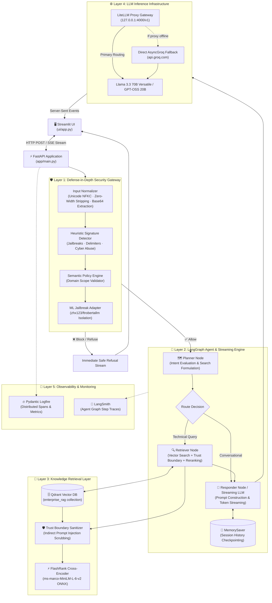
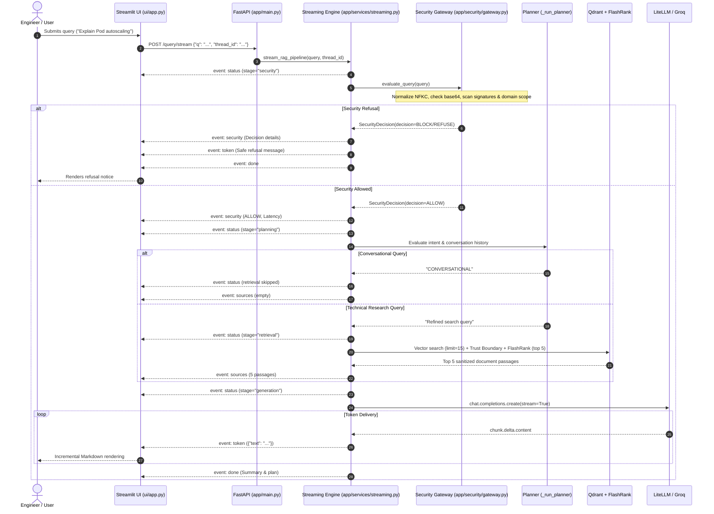
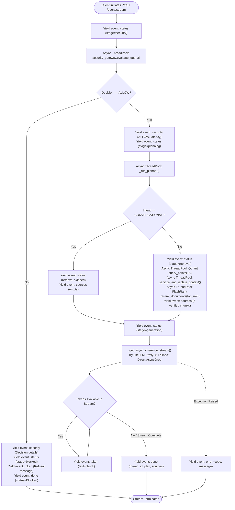
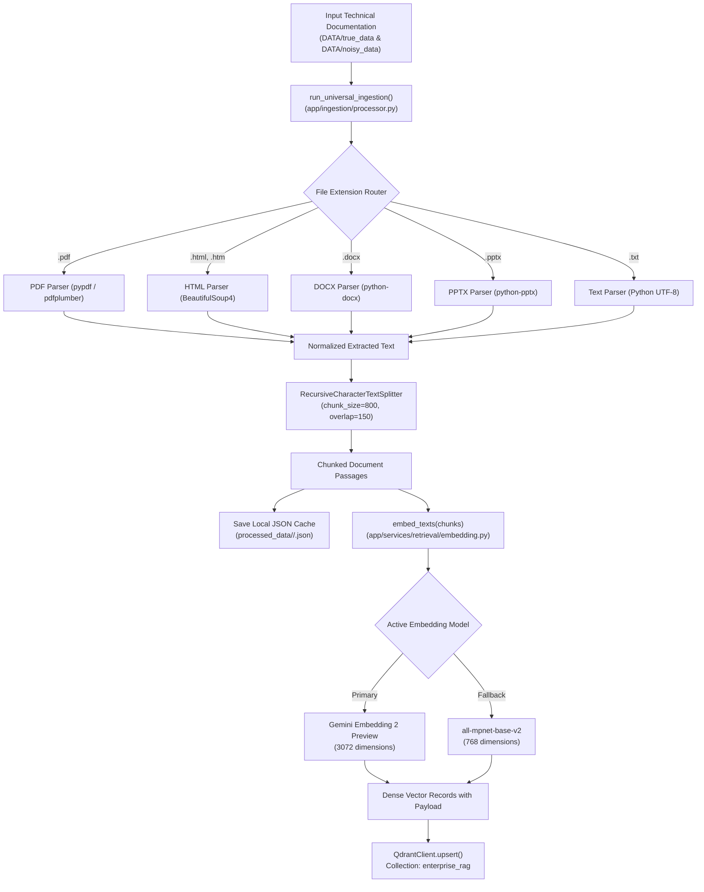
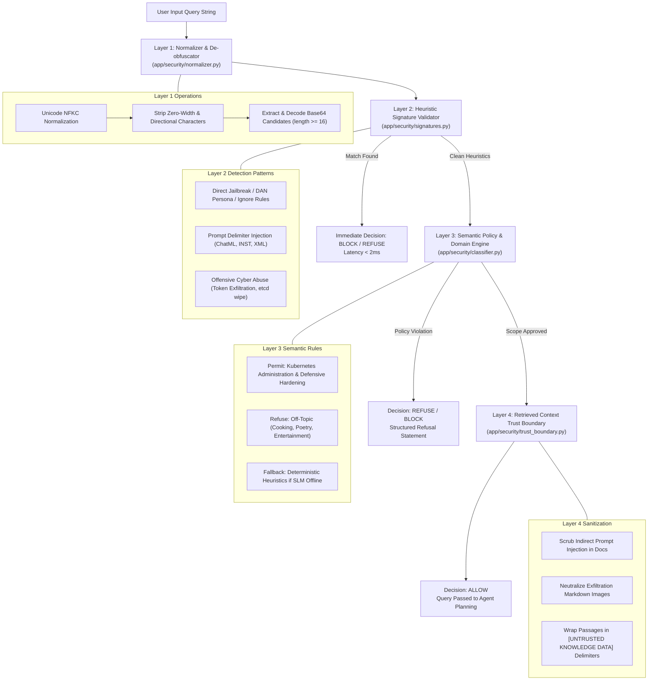
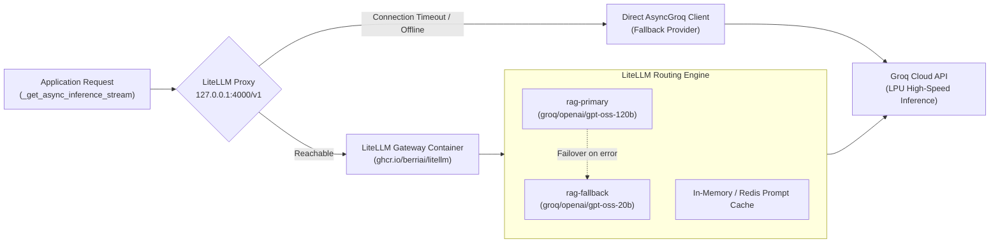

# System Architecture & Technical Specification

## 1. Architectural Overview & Design Principles

The **Enterprise Kubernetes Agentic RAG Platform** is an enterprise-oriented technical assistant designed for container orchestration, cluster administration, and defensive security. 

The architecture moves away from naive, single-prompt RAG tutorials to an engineered, modular platform adhering to these core principles:

1. **Defense-in-Depth AI Security**: Multi-tier security boundaries prevent prompt injection, jailbreaks, and destructive cyber abuse before queries touch agent reasoning or vector storage.
2. **True End-to-End Streaming**: Live Server-Sent Events (SSE) transport model tokens directly to the user interface with single-generation guarantees.
3. **Agentic Context Routing**: LangGraph state machine dynamically differentiates conversational queries from deep technical questions requiring documentation retrieval.
4. **Two-Stage Hybrid Retrieval**: Dense vector similarity search on Qdrant paired with local CPU cross-encoder reranking via FlashRank (`ms-marco-MiniLM-L-6-v2`).
5. **Gateway Resilience & Fallbacks**: Unified OpenAI-compatible routing via LiteLLM with transparent fallbacks to direct Groq provider inference.
6. **Observability by Design**: Distributed tracing and span instrumentation powered by Pydantic Logfire across every execution boundary.

---

## 2. High-Level Architecture Diagram

---

## 3. Verified Component Boundaries & Responsibilities

### A. Presentation Layer (`ui/app.py`)
- **Technology**: Streamlit.
- **Responsibility**: Provides interactive chat interface, consumes Server-Sent Events from `/query/stream`, renders live token markdown incrementally, surfaces security audit decisions, and provides collapsible inspection of retrieved sources.
- **State Management**: Generates and preserves UUID `session_id` in `st.session_state` to link multi-turn conversations.

### B. Application & API Entrypoint (`app/main.py`)
- **Technology**: FastAPI, Uvicorn, Pydantic.
- **Responsibility**: Serves REST and streaming endpoints:
  - `POST /query/stream`: Primary SSE streaming endpoint.
  - `POST /query`: Synchronous execution endpoint.
  - `GET /api/health`: Health and feature status.
  - `GET /api/graph`: Returns Mermaid PNG diagram of the compiled LangGraph workflow.
- **Static Files**: Pre-configured static file mount.

### C. Streaming Orchestration Pipeline (`app/services/streaming.py`)
- **Technology**: Python `asyncio`, Server-Sent Events, `AsyncOpenAI`, `AsyncGroq`.
- **Responsibility**: Coordinates the asynchronous generator lifecycle:
  - Dispatches synchronous components (`evaluate_query`, `_run_planner`, `_run_retriever`) via `loop.run_in_executor()`.
  - Streams structured SSE frames (`status`, `security`, `sources`, `token`, `done`, `error`).
  - Handles client cancellations and network aborts cleanly.
  - Ensures a single LLM generation call, avoiding redundant token generation.

### D. Security & Guardrails Layer (`app/security/`)
- **Technology**: Guardrails AI, Regex, SLM Classifier (`app/security/classifier.py`).
- **Responsibility**: Enforces four-layer defense-in-depth:
  1. `normalizer.py`: Unicode NFKC normalization, zero-width stripping, base64 payload extraction.
  2. `signatures.py`: Regex pattern matching for jailbreaks, system prompt extractions, delimiters, and offensive cyber abuse.
  3. `classifier.py`: Semantic domain scope enforcement via Groq SLM with local heuristic fallback.
  4. `trust_boundary.py`: Neutralizes indirect prompt injection in retrieved document passages.

### E. Agent Orchestration Core (`app/agents/`)
- **Technology**: LangGraph (`StateGraph`), LangChain, `MemorySaver`.
- **Responsibility**:
  - `planner.py`: Analyzes conversation history and decides whether a query is conversational or requires knowledge retrieval.
  - `retriever.py`: Coordinates vector search, context sanitization, and reranking.
  - `responder.py`: Synthesizes final response for synchronous invocations with cache inspection.
  - `graph.py`: Compiles the state graph with memory checkpointing.

### F. Retrieval & Reranking Layer (`app/services/retrieval/`)
- **Technology**: Qdrant Client, FlashRank (`ms-marco-MiniLM-L-6-v2`), Gemini Embeddings, SentenceTransformers.
- **Responsibility**:
  - `embedding.py`: Probes Gemini embeddings (`gemini-embedding-2-preview`, 3072-dim) with automatic fallback to local CPU `sentence-transformers` (`all-mpnet-base-v2`, 768-dim).
  - `qdrant_service.py`: Performs vector similarity queries using Qdrant's modern `query_points` API.
  - `ranking_service.py`: Re-scores candidates using local ONNX cross-encoder reranking.

### G. Gateway & Inference Layer (`app/gateway/`, `litellm/`)
- **Technology**: LiteLLM Proxy Docker container, OpenAI SDK, Groq SDK.
- **Responsibility**:
  - `litellm/config.yaml`: Defines model routing (`rag-primary` to `rag-fallback`), retries, and master keys.
  - `app/gateway/client.py`: Provides `get_langchain_llm()` for LangGraph and extracts cache hit headers.
  - Direct async Groq fallback in `streaming.py` when LiteLLM is not running.

### H. Ingestion Subsystem (`app/ingestion/`)
- **Technology**: `pypdf`, `beautifulsoup4`, `python-docx`, `python-pptx`, LangChain text splitters.
- **Responsibility**: Universal file parser extracting text, chunking text into ~800-character passages, saving JSON metadata in `processed_data/`, and upserting points into Qdrant.

---

## 4. User Query Sequence Diagram

---

## 5. Streaming Lifecycle & Data Flow

---

## 6. Knowledge Ingestion Pipeline Diagram

---

## 7. Security Validation Pipeline Diagram

---

## 8. LLM Gateway & Provider Routing Flow

---

## 9. Error Handling & Failure Boundaries

| Subsystem | Potential Failure Mode | Built-in Mitigation & Recovery |
| :--- | :--- | :--- |
| **Security Gateway** | SLM classifier rate limit or connection timeout | Falls back to deterministic local keyword heuristic classifier (`_heuristic_fallback`). |
| **Security Gateway** | Upstream Hugging Face model config mismatch in `DetectJailbreak` | Safely caught by `MLJailbreakAdapter` and fails open to remaining active heuristic and semantic layers. |
| **Vector DB** | Qdrant unreachable or collection empty | `search_enterprise_knowledge` logs error to Logfire and returns empty list `[]`; agent proceeds without context. |
| **Reranker** | FlashRank ONNX model initialization error | Falls back to original Qdrant cosine similarity ordering. |
| **LLM Gateway** | LiteLLM Docker container offline | Seamlessly falls back to direct `AsyncGroq` inference. |
| **Streaming** | Client closes browser or aborts connection | Captures `asyncio.CancelledError`, cancels thread tasks, and cleanly closes socket. |
| **Streaming** | Mid-generation model disconnection | Emits structured `event: error` frame and closes stream without crashing application. |

---

## 10. Logging & Observability Topology

- **Pydantic Logfire**: Orchestrates distributed tracing across modules. Captures security gateway evaluation latency, planning decisions, Qdrant retrieval candidate counts, reranking durations, and LLM synthesis latency.
- **LangSmith**: Captures fine-grained cyclic state graph executions, state transformations, and node transitions when `LANGSMITH_TRACING=true`.
