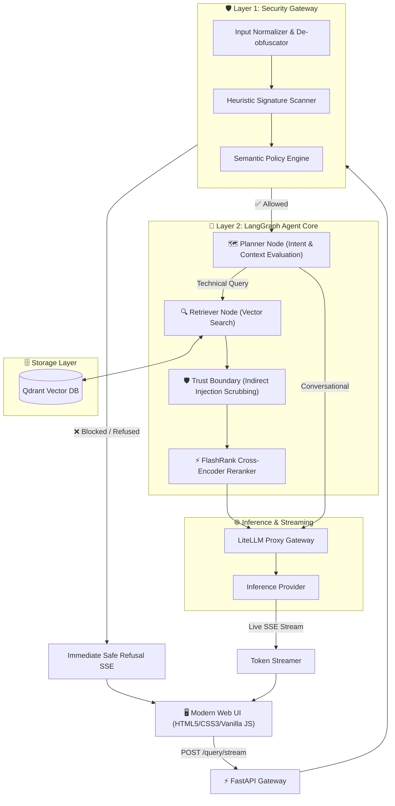

# Enterprise Kubernetes Agentic RAG Platform

[](https://www.python.org/)
[](https://opensource.org/licenses/MIT)
[](https://qdrant.tech/)
[](https://langchain-ai.github.io/langgraph/)
[](docs/SECURITY_ARCHITECTURE.md)

An enterprise-oriented Agentic Retrieval-Augmented Generation (RAG) platform tailored for Kubernetes administration, cluster operations, and defensive security. Features multi-layered prompt injection guardrails, LangGraph intent planning, Qdrant vector retrieval, local FlashRank cross-encoder reranking, and genuine real-time Server-Sent Events (SSE) token streaming.

---

## 🌟 Key Engineering Capabilities

1. **Defense-in-Depth AI Security Gateway**:
   - Multi-layer verification: Unicode NFKC normalization, base64 payload de-obfuscation, zero-width character stripping.
   - High-confidence regex heuristics blocking DAN personas, developer mode escalation, system prompt exfiltration, and delimiter injection.
   - Semantic policy classification via fast SLM, enforcing strict Kubernetes technical scope while permitting legitimate defensive cybersecurity inquiries.
   - **Retrieved Document Trust Boundary**: Neutralizes indirect prompt injection embedded inside documentation or manifests.

2. **Agentic Orchestration with LangGraph**:
   - StateGraph routing queries based on conversational context vs. technical deep-dive needs.
   - In-memory conversation state persistence with `MemorySaver`.

3. **High-Precision Retrieval & Reranking**:
   - Dense vector similarity queries executed against Qdrant (`enterprise_rag` collection).
   - Local CPU Cross-Encoder reranking using **FlashRank** (`ms-marco-MiniLM-L-6-v2`) with zero external API latency.

4. **Genuine End-to-End Token Streaming**:
   - Server-Sent Events (SSE) streaming real-time tokens directly from inference engine to browser.
   - Interactive UI with live token updates, source inspection, and instant generation cancellation (`AbortController`).

5. **Modern Zero-Framework Web UI & Recruiter Showcase**:
   - Clean, dark-mode developer experience built entirely in HTML5, CSS3, and vanilla ES6+ JavaScript.
   - Dedicated Recruiter & Architecture Showcase with live Mermaid.js system diagrams.

6. **100% Free & Self-Hostable**:
   - Zero mandatory paid SaaS services. Evaluated and audited for self-hosted Docker and local CPU inference.

---

## 🏛️ System Architecture



---

## 🚀 Quickstart

### 1. Configure Environment
```powershell
# Copy environment template
cp .env.example .env
```

Supply your API keys in `.env` (Groq free-tier key, Qdrant endpoint, and Gemini key).

### 2. Install Dependencies
```powershell
python -m venv venv
.\venv\Scripts\Activate.ps1
pip install -r requirements.txt
```

### 3. Launch Application
```powershell
uvicorn app.main:app --host 0.0.0.0 --port 8000 --reload
```

- **Chat Interface**: [http://localhost:8000/](http://localhost:8000/)
- **Recruiter Showcase**: [http://localhost:8000/recruiter.html](http://localhost:8000/recruiter.html)
- **API Documentation**: [http://localhost:8000/docs](http://localhost:8000/docs)

### 4. Run Automated Test Suite
```powershell
$env:PYTHONPATH="."
pytest tests/test_security.py -v
```

---

## 📖 Technical Documentation

- [System Architecture](ARCHITECTURE.md)
- [Security Architecture & Adversarial Evaluation](docs/SECURITY_ARCHITECTURE.md)
- [End-to-End Streaming & SSE Protocol](docs/STREAMING_ARCHITECTURE.md)
- [Document Ingestion & Indexing Pipeline](docs/INGESTION_PIPELINE.md)
- [Open Source & Cost Audit](docs/OPEN_SOURCE_AND_COST_AUDIT.md)
- [Local Setup Guide](docs/LOCAL_SETUP.md)
