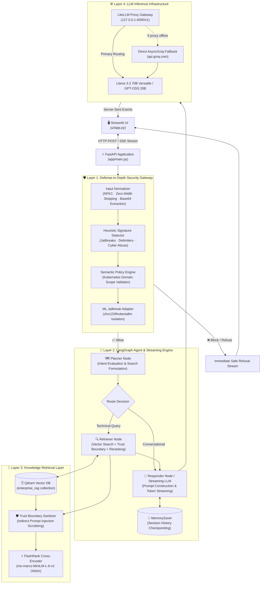
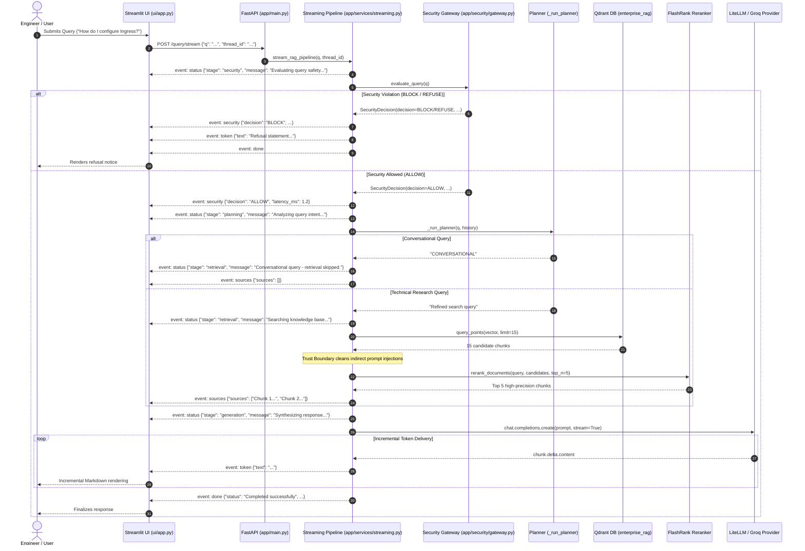

# Enterprise Kubernetes Agentic RAG Platform

[](https://www.python.org/)
[](https://opensource.org/licenses/MIT)
[](https://qdrant.tech/)
[](https://langchain-ai.github.io/langgraph/)
[](docs/security/security-overview.md)
[](docs/development/testing.md)

An enterprise-grade, production-oriented Agentic Retrieval-Augmented Generation (RAG) platform specialized for Kubernetes cluster architecture, container orchestration, administrative operations, and defensive security. Features defense-in-depth AI safety guardrails, LangGraph intent planning, dense vector retrieval over Qdrant, local CPU cross-encoder reranking with FlashRank, an OpenAI-compatible LiteLLM proxy gateway with Groq failover, and true end-to-end Server-Sent Events (SSE) token streaming.

---

## 1. Project Title and Overview

The **Enterprise Kubernetes Agentic RAG Platform** provides cluster administrators, DevOps engineers, and security analysts with an intelligent, conversational interface to query complex infrastructure documentation, Kubernetes manifests, troubleshooting guides, and defensive security best practices.

Rather than relying on basic tutorial-style RAG pipelines, the platform implements a modular architecture incorporating defensive security filtering before inference, dynamic intent routing, context sanitization, two-stage semantic retrieval, and real-time streaming transport.

---

## 2. Current Problem Statement

Standard RAG architectures often suffer from critical operational flaws:
- **Vulnerability to Prompt Injections**: Direct and indirect prompt injections embedded in documentation or user prompts can alter model instructions, exfiltrate internal system prompts, or yield destructive cluster commands.
- **Artificial Streaming & Double Generation**: Many implementations either generate answers in full before streaming character-by-character artificially, or execute separate model calls that double latency and token costs.
- **Lack of Conversational Memory vs. Research Routing**: Static retrieval pipelines run vector search on every turn (including simple greetings or follow-up questions), introducing unnecessary latency and degrading conversational fluency.
- **Imprecise Cosine Vector Search**: Vector distance metrics alone struggle with nuanced technical syntax (e.g. distinguishing subtle flag differences in `kubectl` commands or complex networking configurations).
- **Vendor Lock-In and Brittle Gateway Couplings**: Direct integrations with single inference APIs lack fallback redundancy when upstream provider rate limits or outages occur.

---

## 3. Project Objectives

- **Enforce Defense-in-Depth AI Security**: Filter malicious inputs across multiple verification boundaries (normalization, heuristic signatures, semantic scope validation, and indirect injection scrubbing) before reaching the agent.
- **Deliver True Real-Time Streaming**: Stream model tokens incrementally over standard Server-Sent Events (SSE) directly to the user interface with single-generation efficiency.
- **Provide Dynamic Context Planning**: Use LangGraph state machines to dynamically evaluate whether an inquiry requires documentation retrieval or conversational memory synthesis.
- **Maximize Retrieval Precision**: Pair high-recall Qdrant vector similarity queries with local CPU cross-encoder reranking via FlashRank (`ms-marco-MiniLM-L-6-v2`).
- **Ensure Operational Resilience**: Implement LiteLLM gateway routing with automated fallback to direct asynchronous Groq inference.

---

## 4. Key Features

- **Defense-in-Depth Security Gateway**: Unicode NFKC normalization, base64 payload extraction, regex heuristic signatures, and SLM-based semantic policy classification.
- **Retrieved Document Trust Boundary**: Neutralizes indirect prompt injections, malicious scripts, and exfiltration markdown links found within retrieved documentation.
- **Genuine End-to-End Token Streaming**: Real-time SSE streaming emitting structured events (`status`, `security`, `sources`, `token`, `done`, `error`).
- **LangGraph Agentic Workflow**: StateGraph architecture with `MemorySaver` thread checkpointing and conditional planner routing.
- **Two-Stage Semantic Retrieval**: Qdrant modern `query_points` dense vector queries coupled with local CPU cross-encoder reranking.
- **Dual-Mode Embeddings**: Primary Google Gemini embeddings (`gemini-embedding-2-preview`, 3072-dim) with automatic fallback to local CPU `sentence-transformers` (`all-mpnet-base-v2`, 768-dim).
- **Interactive Streamlit UI**: Dark-mode web interface (`ui/app.py`) featuring live token streaming, collapsible retrieved source inspection, and security stage indicators.
- **Recruiter-Facing Engineering Showcase**: Standalone Apple-inspired technical product showcase (`recruiter-site/` and `/` on FastAPI) featuring light-mode frosted-glass aesthetics, local Mermaid.js architecture diagrams with expand/modal controls, component inspector sheets, and automated GitHub Pages deployment.
- **Comprehensive Automated Test Suite**: 24 tests validating security boundaries, obfuscation handling, SSE framing, single generation guarantees, and error handling.

---

## 5. Current System Architecture

The platform follows a modular layered architecture running as a cohesive application:
1. **User Interface Layer**: Interactive Streamlit frontend (`ui/app.py`) communicating with FastAPI over HTTP and SSE.
2. **Backend API Layer**: FastAPI server (`app/main.py`) exposing streaming (`/query/stream`), synchronous (`/query`), health (`/api/health`), and graph visualization (`/api/graph`) endpoints.
3. **Security Gateway**: Multi-layer security validation pipeline (`app/security/`) combining normalization, heuristic signatures, Guardrails AI custom validators, and context trust boundaries.
4. **Agent Orchestrator**: LangGraph cyclic state machine (`app/agents/`) directing planning, retrieval, and synthesis.
5. **Retrieval & Reranking Subsystem**: Dense vector retrieval on Qdrant and in-process ONNX cross-encoder reranking via FlashRank.
6. **Inference Gateway**: LiteLLM proxy container with native failover to direct `AsyncGroq` inference.
7. **Distributed Observability**: Deep tracing across all modules powered by Pydantic Logfire and LangSmith.

---

## 6. Architecture Diagram



---

## 7. Complete User Query Lifecycle



---

## 8. Streaming Architecture and Behaviour

The streaming pipeline in `app/services/streaming.py` utilizes asynchronous generators to yield Server-Sent Events (SSE) conforming to the specification:
```text
event: <eventType>
data: <jsonPayload>

```

### Event Types
- `status`: Emits progress indicators across stages (`security`, `planning`, `retrieval`, `generation`, `blocked`).
- `security`: Emits audit results including decision (`ALLOW`, `BLOCK`, `REFUSE`), category, confidence score, detector list, and latency.
- `sources`: Delivers sanitized reference documents retrieved from vector storage.
- `token`: Delivers live token chunks incrementally as emitted by the inference model.
- `done`: Emits stream completion metadata, thread identifier, and thought process records.
- `error`: Emits structured failure messages if mid-stream generation fails.

### Cancellation Handling
If the client disconnects or aborts the connection, `asyncio.CancelledError` is caught, thread tasks are halted, and sockets are cleanly closed without leaking resources.

---

## 9. Security and Guardrails

The security gateway in `app/security/` enforces a multi-tiered defense:
1. **Normalization & De-obfuscation (`normalizer.py`)**: Strips invisible zero-width unicode characters, converts homoglyphs via NFKC normalization, and extracts and decodes candidate base64 payloads ($\ge 16$ chars).
2. **Heuristic Signature Scanner (`signatures.py`)**: Scans for direct instruction overrides ("ignore previous instructions"), DAN personas, developer mode escalation, system delimiter tokens (`<|im_start|>`, `[INST]`), and offensive cyber attacks (token exfiltration, etcd wiping).
3. **Semantic Policy Classifier (`classifier.py`)**: Evaluates domain alignment via Groq SLM with automatic fallback to local heuristic evaluation. Permits Kubernetes architecture and defensive security analysis (e.g. RBAC privilege escalation prevention), while refusing out-of-scope queries (recipes, poetry).
4. **Context Trust Boundary (`trust_boundary.py`)**: Scrubs indirect prompt injections and markdown exfiltration images from retrieved documentation, enclosing content inside explicit `[UNTRUSTED KNOWLEDGE DATA]` boundary blocks.

---

## 10. Agent and Planning Workflow

The agentic core in `app/agents/` implements a LangGraph cyclic state machine:
- **Planner Node (`nodes/planner.py`)**: Evaluates the conversation history and latest user query to route between `"CONVERSATIONAL"` and technical deep-dive searches.
- **Retriever Node (`nodes/retriever.py`)**: Executes Qdrant search, applies trust-boundary isolation, and runs FlashRank reranking.
- **Responder Node (`nodes/responder.py`)**: Synthesizes responses for synchronous invocations and reads the `x-litellm-cache-status` header to detect cache hits.
- **Memory Checkpointing**: Uses `MemorySaver` to preserve multi-turn history indexed by `thread_id`.

---

## 11. LLM Gateway and Provider Management

LLM requests are decoupled through an OpenAI-compatible gateway:
- **Primary Gateway**: LiteLLM proxy container (`ghcr.io/berriai/litellm`) running on port 4000, configured via `litellm/config.yaml`.
- **Model Routing**: Routes `rag-primary` to Groq (`groq/openai/gpt-oss-120b`) with automated fallback to `rag-fallback` (`groq/openai/gpt-oss-20b`).
- **Direct Groq Fallback**: In `app/services/streaming.py`, if the LiteLLM proxy container is offline, the pipeline catches the timeout and falls back directly to `AsyncGroq`, ensuring zero downtime during development.

---

## 12. Knowledge Ingestion Pipeline

The universal ingestion processor in `app/ingestion/processor.py` processes raw technical documents:
- **Format Loaders (`app/ingestion/loaders/`)**: Specialized parsers for PDF (`pypdf` / `pdfplumber`), HTML (`beautifulsoup4`), Word (`python-docx`), PowerPoint (`python-pptx`), and plain text.
- **Semantic Chunking (`app/ingestion/chunking/splitter.py`)**: Uses LangChain's `RecursiveCharacterTextSplitter` with 800-character chunk sizes and 150-character overlaps.
- **Local JSON Caching**: Extracted chunk metadata is cached in `processed_data/<source_type>/<filename>.json` for offline auditing.
- **Vector Indexing**: Batched vector generation upserts points into Qdrant collection `enterprise_rag`.

---

## 13. Embedding and Vector Retrieval

- **Dual-Mode Embedding Architecture (`app/services/retrieval/embedding.py`)**:
  - **Primary**: Google Gemini `models/gemini-embedding-2-preview` (3072 dimensions) with 4-stage exponential backoff retry for quota resilience.
  - **Fallback**: Local CPU `sentence-transformers` (`all-mpnet-base-v2`, 768 dimensions) for offline operations.
- **Vector Search (`app/services/retrieval/qdrant_service.py`)**: Dense similarity search via modern `query_points` API over Qdrant.
- **Cross-Encoder Reranking (`app/services/retrieval/ranking_service.py`)**: Local CPU semantic reranking using quantized ONNX `ms-marco-MiniLM-L-6-v2` via FlashRank.

---

## 14. Technology Stack

| Layer | Technologies |
| :--- | :--- |
| **User Interface** | Streamlit, Requests, Python 3.10+ |
| **API & Backend** | FastAPI, Uvicorn, Pydantic v2, Server-Sent Events (SSE) |
| **AI Security** | Guardrails AI, Custom Validators, Regex Heuristics, Groq SLM |
| **Agent Orchestration** | LangGraph, LangChain, MemorySaver |
| **Vector DB & Retrieval** | Qdrant Client, FlashRank Cross-Encoder (ONNX) |
| **Embeddings** | Google Generative AI Embeddings, SentenceTransformers |
| **LLM Gateway & Inference** | LiteLLM Docker Proxy, Groq Cloud API, OpenAI SDK, Groq SDK |
| **Document Processing** | PyPDF, PDFPlumber, BeautifulSoup4, python-docx, python-pptx |
| **Observability** | Pydantic Logfire, LangSmith, Loguru |
| **Testing** | Pytest, Pytest-Asyncio |

---

## 15. Repository Structure

```text
RAG CHATBOT FOR KUBERNETES/
├── app/
│   ├── agents/
│   │   ├── nodes/
│   │   │   ├── planner.py               # Intent planner node
│   │   │   ├── responder.py             # Synchronous responder node
│   │   │   └── retriever.py             # Retrieval & reranker node
│   │   ├── graph.py                     # LangGraph StateGraph compilation
│   │   └── state.py                     # AgentState data model
│   ├── gateway/
│   │   ├── client.py                    # LiteLLM LangChain client & cache status
│   │   └── __init__.py
│   ├── ingestion/
│   │   ├── chunking/
│   │   │   └── splitter.py              # Recursive text splitter (800/150)
│   │   ├── loaders/
│   │   │   ├── html.py                  # HTML parser (BeautifulSoup4)
│   │   │   ├── office.py                # Office parser (DOCX, PPTX)
│   │   │   ├── pdf.py                   # PDF parser (pypdf, pdfplumber)
│   │   │   └── text.py                  # Plain text parser
│   │   └── processor.py                 # Universal document ingestion engine
│   ├── security/
│   │   ├── classifier.py                # Semantic policy & domain classifier (Groq SLM)
│   │   ├── gateway.py                   # Unified Security Gateway orchestrator
│   │   ├── guardrails_adapter.py        # Guardrails AI framework integration & custom validators
│   │   ├── models.py                    # Decision and SecurityCategory enums
│   │   ├── normalizer.py                # Unicode NFKC, zero-width, base64 extractor
│   │   ├── signatures.py                # High-confidence regex pattern scanner
│   │   └── trust_boundary.py            # Indirect prompt injection context scrubber
│   ├── services/
│   │   ├── retrieval/
│   │   │   ├── embedding.py             # Dual-mode embedding service (Gemini / ST)
│   │   │   ├── qdrant_service.py        # Qdrant query_points vector search
│   │   │   └── ranking_service.py       # FlashRank local cross-encoder reranker
│   │   └── streaming.py                 # End-to-end async SSE streaming pipeline
│   ├── config.py                        # Centralized application settings
│   └── main.py                          # FastAPI application entrypoint
│
├── DATA/                                # Benchmark technical documentation
├── docs/                                # Technical documentation suite
│   ├── architecture/                    # System overview, lifecycle, streaming, interactions
│   ├── deployment/                      # Docker Compose & production setup
│   ├── development/                     # Setup, configuration reference, testing guide
│   ├── gateway/                         # LLM gateway & routing specification
│   ├── retrieval/                       # Ingestion, embeddings, and retrieval workflows
│   └── security/                        # Security architecture & guardrails workflow
├── litellm/
│   └── config.yaml                      # LiteLLM proxy configuration & model routes
├── processed_data/                      # Local JSON cache of extracted chunk metadata
├── tests/
│   ├── conftest.py                      # Global test fixtures & telemetry isolation
│   ├── test_security.py                 # 18 Security boundary & attack tests
│   └── test_streaming.py                # 6 Streaming lifecycle & SSE protocol tests
├── ui/
│   └── app.py                           # Modern interactive Streamlit chat interface
├── recruiter-site/                      # Apple-inspired recruiter-facing engineering showcase
│   ├── index.html                       # Semantic HTML5 showcase landing page (Light Mode only)
│   ├── src/                             # Source CSS (Tailwind), JS modules, and Apple design tokens
│   │   ├── css/                         # Apple-inspired light-mode stylesheet & glassmorphism
│   │   ├── js/                          # Mermaid diagrams, component drawer, and security sandbox
│   │   └── assets/                      # Minimalist favicon and graphics
│   ├── dist/                            # Ready-to-deploy static build for GitHub Pages
│   └── README.md                        # Local preview & GitHub Pages deployment guide
│
├── .env.example                         # Environment variable template
├── .gitignore                           # Git ignore rules
├── ARCHITECTURE.md                      # Comprehensive system engineering architecture
├── docker-compose.yml                   # LiteLLM proxy Docker service definition
├── download_data.py                     # Benchmark dataset downloader utility
├── pytest.ini                           # Pytest configuration
├── README.md                            # Project overview and reference
└── requirements.txt                     # Application dependencies
```

---

## 16. Prerequisites

- **Python**: Version `3.10` or higher (verified on Python 3.10.11).
- **API Keys**:
  - Groq API Key (Free tier): For inference and semantic security classification.
  - Qdrant Cluster Endpoint & API Key: Qdrant Cloud free tier or local instance.
  - Gemini API Key (Optional): For Gemini embeddings (local fallback active if omitted).
  - Pydantic Logfire Token (Optional): For distributed tracing.
- **Docker & Docker Compose** (Optional): For running the LiteLLM gateway proxy.

---

## 17. Environment Configuration

Copy `.env.example` to `.env`:
```powershell
cp .env.example .env
```

Set your configuration values:
```ini
GROQ_API_KEY=gsk_your_groq_api_key
GROQ_FALLBACK_API_KEY=gsk_your_groq_api_key

QDRANT_CLUSTER_ENDPOINT=https://your-cluster-url.qdrant.tech
QDRANT_API_KEY=your_qdrant_api_key

# Optional: Gemini embeddings (leave blank to use local sentence-transformers)
GEMINI_API_KEY=your_gemini_key

# Optional: LiteLLM Gateway
LITELLM_BASE_URL=http://127.0.0.1:4000/v1
LITELLM_MASTER_KEY=sk-local-dev-key

# UI and Backend URL
BACKEND_URL=http://127.0.0.1:8000
```

---

## 18. Installation and Setup

```powershell
# Create virtual environment
python -m venv venv

# Activate virtual environment
.\venv\Scripts\Activate.ps1   # Windows PowerShell
# source venv/bin/activate    # Linux / macOS

# Install dependencies
pip install --upgrade pip
pip install -r requirements.txt
```

---

## 19. Running the Application

### Step 1: Start the FastAPI Backend
```powershell
uvicorn app.main:app --host 127.0.0.1 --port 8000 --reload
```

### Step 2: Start the Streamlit Chat UI
In a separate terminal:
```powershell
streamlit run ui/app.py --server.port 8501
```

Open your browser to:
- **Recruiter Showcase Website**: [http://localhost:8000/](http://localhost:8000/) *(or via `python -m http.server 3000 --directory website` at [http://localhost:3000/](http://localhost:3000/))*
- **Chat Interface**: [http://localhost:8501/](http://localhost:8501/) *(or live at [chatkubernetes.streamlit.app](https://chatkubernetes.streamlit.app))*
- **FastAPI Interactive Docs**: [http://localhost:8000/docs](http://localhost:8000/docs)
- **FastAPI Health Endpoint**: [http://localhost:8000/api/health](http://localhost:8000/api/health)

---

## 20. Running with Docker, Where Supported

To run the LiteLLM proxy gateway in Docker:
```powershell
docker compose up -d litellm
```
Verify the container status:
```powershell
docker compose ps
docker compose logs -f litellm
```

---

## 21. Running Tests

Run the complete automated test suite:
```powershell
pytest
```

Run with verbose test names:
```powershell
pytest -v
```

Run specific test files:
```powershell
pytest tests/test_security.py -v
pytest tests/test_streaming.py -v
```

---

## 22. API Endpoints

| Method | Endpoint | Description |
| :--- | :--- | :--- |
| `POST` | `/query/stream` | Primary streaming endpoint returning real-time Server-Sent Events (`text/event-stream`). |
| `POST` | `/query` | Synchronous query endpoint returning full answer JSON payload. |
| `GET` | `/api/health` | Service health check and active feature summary. |
| `GET` | `/api/graph` | Returns PNG diagram of the compiled LangGraph workflow. |

---

## 23. Configuration Reference

See [Configuration Reference](docs/development/configuration.md) for full details on all environment variables, default values, and secrets management.

---

## 24. Logging and Monitoring

- **Pydantic Logfire**: Distributed span tracing configured in `app/main.py`. Captures request lifecycles, security gateway decisions, Qdrant search latency, FlashRank reranking times, and LLM token synthesis durations.
- **LangSmith**: Native LangChain step tracing capturing node state transitions and agent decisions.

---

## 25. Current Limitations and Known Issues

- **In-Memory MemorySaver**: Conversation history is currently checkpointed in-memory. Restarting the FastAPI backend clears active conversational memory. Production deployments require a persistent checkpointer (e.g. Redis or Postgres).
- **Rate Limits on Free Inference**: Groq free-tier quotas (30 requests per minute) apply to live inference. For high-volume production, configure multiple fallback keys or self-host an Ollama inference instance.
- **Hugging Face DetectJailbreak Upstream Config**: Optional Hugging Face ML jailbreak validator (`zhx123/ftrobertallm`) contains integer `id2label` configurations that trigger dataclass validation errors in modern Transformers. The platform's `MLJailbreakAdapter` safely catches and isolates this issue, failing open to active heuristic and semantic layers.

---

## 26. Future Improvements

- **Persistent Redis Checkpointing**: Transition LangGraph memory checkpointing to Redis or PostgreSQL for distributed multi-instance deployment.
- **Expanded Semantic Policy Rules**: Add automated rule tuning for Kubernetes CRD and Operator custom manifests.
- **Evaluation Suite Re-integration**: Build an automated CI/CD evaluation gate using synthetic benchmark questions to verify faithfulness and relevance metrics on pull requests.

---

## 27. Project Status

The codebase is fully audited, verified, and operational. All 24 security and streaming tests pass. The documentation represents the actual runtime implementation.

---

## 📖 Detailed Technical Documentation

- [System Architecture](ARCHITECTURE.md)
- [System Overview](docs/architecture/system-overview.md)
- [Request Lifecycle](docs/architecture/request-lifecycle.md)
- [Streaming Architecture & SSE Protocol](docs/architecture/streaming-architecture.md)
- [Component Interactions](docs/architecture/component-interactions.md)
- [Security Architecture Overview](docs/security/security-overview.md)
- [Guardrails Workflow](docs/security/guardrails-workflow.md)
- [Document Ingestion Pipeline](docs/retrieval/ingestion-pipeline.md)
- [Embedding Strategy](docs/retrieval/embedding-strategy.md)
- [Retrieval & Reranking Workflow](docs/retrieval/retrieval-workflow.md)
- [LLM Gateway & Routing](docs/gateway/llm-gateway.md)
- [Local Development Setup](docs/development/setup.md)
- [Configuration Reference](docs/development/configuration.md)
- [Testing Guide](docs/development/testing.md)
- [Docker Deployment Guide](docs/deployment/docker-and-deployment.md)
