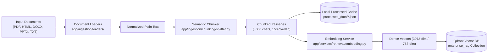

# Document Ingestion & Vector Indexing Pipeline

## 1. Overview
The ingestion pipeline processes technical documentation across multiple formats (PDF, HTML, DOCX, PPTX, TXT), decomposes documents into semantic chunks, generates dense vector representations, and indexes them into Qdrant vector database under the `enterprise_rag` collection.

---

## 2. Ingestion Architecture Flow

---

## 3. Preservation of Ingestion Architecture
- **Non-destructive indexing**: Existing collections, vector points, and embedding dimensions are completely preserved.
- **Dual-mode Embedder**:
  - Primary: Google Gemini `gemini-embedding-2-preview` (3072 dimensions) with exponential backoff for quota limits.
  - Fallback: Local `sentence-transformers` (`all-mpnet-base-v2`, 768 dimensions) for offline/air-gapped operations.
