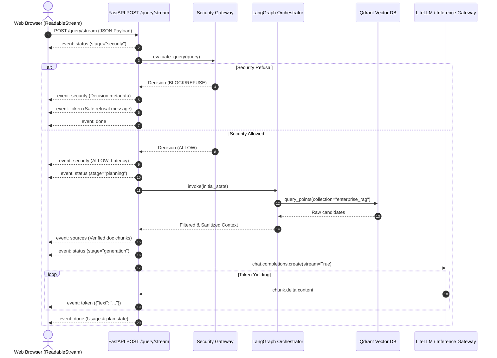

# Streaming Architecture & SSE Protocol Specification

## 1. Overview
The platform implements **genuine end-to-end token streaming** from the inference provider down to the client web browser using Server-Sent Events (SSE). Unlike artificial delays or simulated character loops, tokens are rendered incrementally as they arrive from the model engine.

---

## 2. Token Streaming Lifecycle



---

## 3. SSE Event Protocol Specification

All events follow the standard SSE text framing:
```
event: <eventType>
data: <JSON string>

```

### Supported Event Types:

1. **`status`**: Emits operational progress indicators (security, planning, retrieval, generation).
   ```json
   { "stage": "security", "message": "Evaluating query safety & domain scope..." }
   ```

2. **`security`**: Emits structured security audit decisions before LLM generation begins.
   ```json
   {
     "decision": "ALLOW",
     "category": "BENIGN",
     "confidence": 0.95,
     "reason": "Matches Kubernetes technical scope",
     "detectors": ["HeuristicSignatureDetector", "SemanticPolicyClassifier"],
     "latency_ms": 1.4
   }
   ```

3. **`sources`**: Emits sanitized reference documents retrieved from Qdrant.
   ```json
   {
     "sources": [
       "CONTENT: Kubernetes Deployments allow declarative updates...",
       "CONTENT: RollingUpdate strategy parameters include maxSurge..."
     ]
   }
   ```

4. **`token`**: Live token fragments streamed directly from inference.
   ```json
   { "text": "Kubernetes " }
   ```

5. **`done`**: Stream completion marker with session information.
   ```json
   {
     "thread_id": "session_abc123",
     "status": "Completed successfully",
     "sources": [...],
     "thought_process": ["Intent: Technical", "Context Retrieved & Sanitized"]
   }
   ```

6. **`error`**: Controlled error payload if an exception occurs mid-stream.
   ```json
   { "code": "GENERATION_ERROR", "message": "Inference gateway timeout" }
   ```

---

## 4. Frontend Stream Consumption
- Built using the native browser `fetch()` API combined with `ReadableStream` and `TextDecoder`.
- Handles partial chunk splitting across SSE buffer boundaries gracefully.
- Integrates `AbortController` to allow users to instantly halt streaming at any time.
