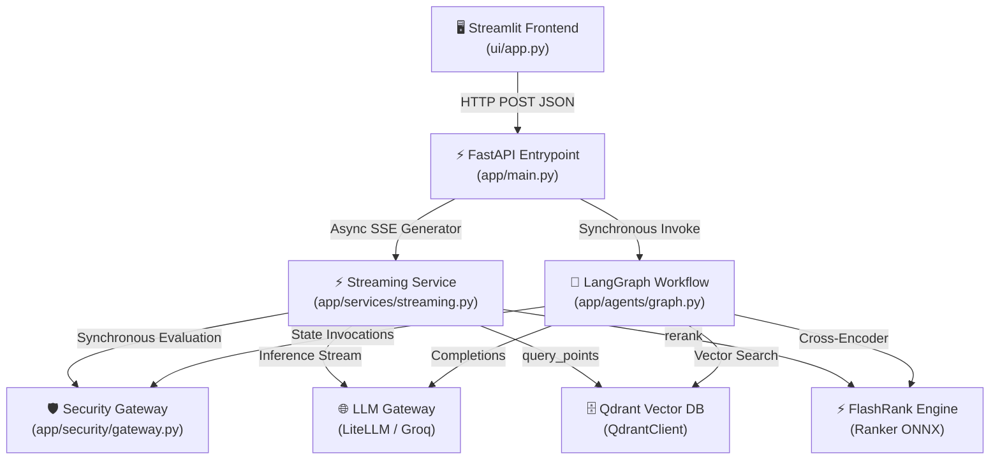

# Component Interactions & Data Contracts

## 1. Overview

This document outlines the interfaces, data models, and communication contracts connecting components across the **Enterprise Kubernetes Agentic RAG Platform**.

---

## 2. Component Interaction Matrix



---

## 3. Data Contracts & Models

### A. HTTP Request Payload (`QueryRequest`)
Defined in `app/main.py`:
```python
class QueryRequest(BaseModel):
    q: str
    thread_id: Optional[str] = "default_user"
```
- `q`: Non-empty user prompt string.
- `thread_id`: Unique identifier tying conversational turns to a memory session.

### B. Security Decision (`SecurityDecision`)
Defined in `app/security/models.py`:
```python
class Decision(str, Enum):
    ALLOW = "ALLOW"
    BLOCK = "BLOCK"
    REFUSE = "REFUSE"

class SecurityCategory(str, Enum):
    BENIGN = "BENIGN"
    OFF_TOPIC = "OFF_TOPIC"
    JAILBREAK = "JAILBREAK"
    PROMPT_INJECTION = "PROMPT_INJECTION"
    CYBER_ABUSE = "CYBER_ABUSE"
    POLICY_VIOLATION = "POLICY_VIOLATION"

class SecurityDecision(BaseModel):
    decision: Decision
    category: SecurityCategory
    confidence: float
    reason: str
    detectors: List[str]
    latency_ms: float = 0.0
    safe_response: Optional[str] = None
```

### C. Agent State Contract (`AgentState`)
Defined in `app/agents/state.py`:
```python
class AgentState(TypedDict):
    messages: Annotated[List[dict], operator.add]
    current_query: str
    documents: List[str]
    plan: List[str]
    status: str
    final_answer: str
```
- `messages`: Accumulator list appending user and assistant messages across turns.
- `current_query`: Either `"CONVERSATIONAL"` or the synthesized search term.
- `documents`: List of reranked, sanitized document text passages.
- `plan`: Step-by-step audit record of agent decisions and status markers.
- `final_answer`: Final generated assistant text.

### D. Vector Record Contract
Stored in Qdrant collection `enterprise_rag`:
```json
{
  "id": "uuid-v4-string",
  "vector": [0.0123, -0.0456, ...],
  "payload": {
    "text": "Extracted semantic passage text...",
    "source": "cronjobs.docx",
    "source_type": "true"
  }
}
```

---

## 4. Communication Protocols

| Interface Boundary | Protocol | Serialization | Synchronicity |
| :--- | :--- | :--- | :--- |
| **UI → FastAPI** | HTTP/1.1 | JSON | Asynchronous (SSE stream) |
| **FastAPI → Streaming Pipeline** | In-process Python | AsyncGenerator[str] | Asynchronous coroutine |
| **Streaming Pipeline → Security Gateway** | Python Function Call | In-memory Object | Sync via `run_in_executor` |
| **Streaming Pipeline → Qdrant** | gRPC / HTTP REST | JSON Payload | Sync via `run_in_executor` |
| **Streaming Pipeline → FlashRank** | In-process ONNX | Python Objects | Sync via `run_in_executor` |
| **Streaming Pipeline → LiteLLM / Groq** | HTTP/1.1 / HTTP/2 | OpenAI-compatible SSE | Native Async (`AsyncOpenAI` / `AsyncGroq`) |
