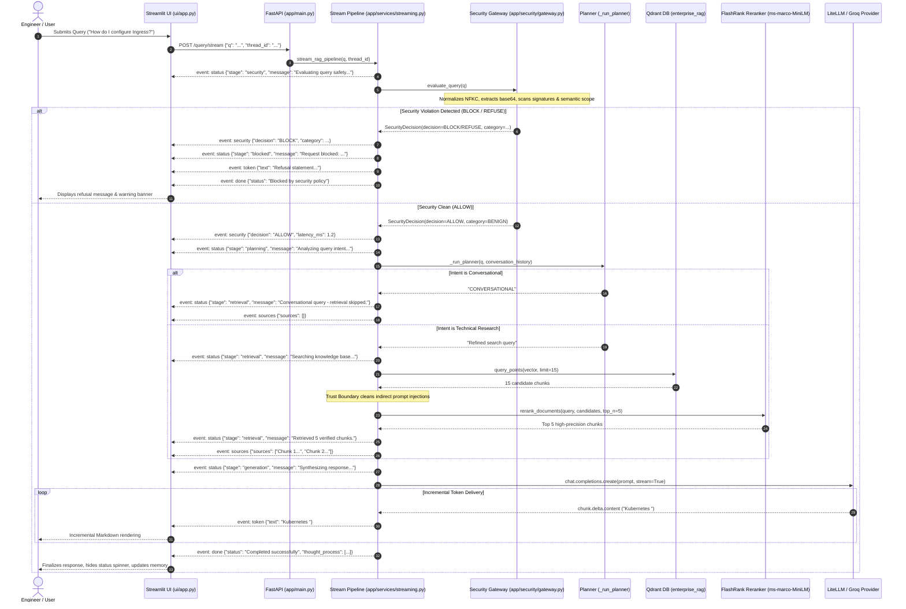

# Complete Request Lifecycle

## 1. Overview

This document details the exact sequence of operations that occur when a user submits a query to the **Enterprise Kubernetes Agentic RAG Platform**. The platform supports two operational paths:
1. **Streaming Endpoint (`POST /query/stream`)**: Primary production path delivering real-time Server-Sent Events (SSE).
2. **Synchronous Endpoint (`POST /query`)**: Preserved for backwards compatibility and batch evaluation integrations.

---

## 2. End-to-End Streaming Query Sequence



---

## 3. Detailed Step Breakdown

### Step 1: Client Request Ingestion
- User enters text in the Streamlit web interface (`ui/app.py`).
- The client constructs an HTTP payload:
  ```json
  {
    "q": "How to scale deployment replicas in Kubernetes?",
    "thread_id": "session_a8f9c10e"
  }
  ```
- The client issues an HTTP `POST` to `/query/stream` with `Accept: text/event-stream`.
- A streaming connection is established using `requests.post(..., stream=True)` with indefinite read timeout to support long answers.

### Step 2: Gate 1 — Security Evaluation
- Before initializing any agent planning or vector search, the query enters `app.security.gateway.security_gateway.evaluate_query`.
- **Normalization**: Zero-width unicode characters are stripped, NFKC decomposition applied, and base64 chunks decoded.
- **Signatures**: Regex heuristics scan for system prompt extraction, jailbreaks, delimiters, and offensive cyber abuse.
- **Scope Classification**: The semantic policy engine validates whether the inquiry falls within Kubernetes, container operations, or defensive security.
- **Short-Circuit Refusal**: If flagged:
  1. An `event: security` payload is yielded with category and detector metadata.
  2. An `event: token` payload is emitted carrying the safe response text.
  3. An `event: done` payload terminates the stream.
  4. Vector search and LLM synthesis are completely bypassed (0 LLM inference tokens spent).

### Step 3: Gate 2 — Intent Planning
- Clean queries advance to planning.
- In `_run_planner`, the LLM assesses conversation history alongside the current user query.
- Output:
  - `"CONVERSATIONAL"`: Conversational greetings, politeness, or memory inquiries (e.g., "What was my name?"). Knowledge retrieval is skipped.
  - Refined technical query string: Technical inquiries about Kubernetes, CNI, storage, Pods, or YAML configurations.

### Step 4: Gate 3 — Knowledge Retrieval & Trust Boundary
- For technical queries:
  1. Dense vector embedding generated via `embed_query`.
  2. Modern Qdrant `query_points` API retrieves the top 15 candidate documents.
  3. **Trust Boundary Isolation**: Retrieved text runs through `sanitize_and_isolate_context()`, stripping indirect prompt injection patterns and markdown exfiltration images.
  4. **FlashRank Reranking**: The cross-encoder re-scores the 15 candidates against the query and returns the top 5 most semantically relevant chunks.
  5. The sanitized chunks are yielded to the frontend via `event: sources`.

### Step 5: Gate 4 — Live Token Synthesis
- Context and conversation history are combined into the technical synthesis prompt (`_build_responder_prompt`).
- An asynchronous streaming completion request is initiated via `_get_async_inference_stream()`:
  - First attempts the LiteLLM proxy gateway (`http://127.0.0.1:4000/v1`).
  - If unreachable, falls back seamlessly to direct `AsyncGroq`.
- Live token fragments are yielded over SSE as `event: token`.
- On completion, `event: done` delivers the thought process summary and session identifiers.
