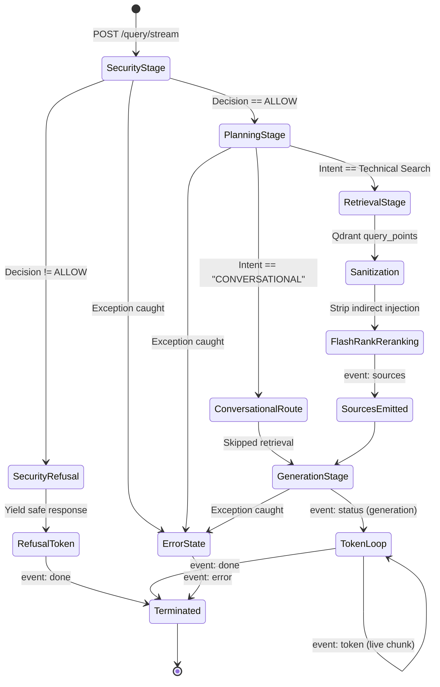

# Streaming Architecture & SSE Protocol Specification

## 1. Architectural Foundations

The streaming subsystem in `app/services/streaming.py` implements **true end-to-end token streaming** from the inference provider directly to the client browser using Server-Sent Events (SSE).

### Design Goals:
1. **Zero Artificial Delay**: Tokens are rendered incrementally as emitted by the inference engine (Llama 3.3 on Groq or LiteLLM proxy).
2. **Non-blocking Event Loop**: Synchronous components (Qdrant search, FlashRank inference, LangChain planner) run inside worker threads via `loop.run_in_executor()` to prevent FastAPI event loop starvation.
3. **Single Generation Call**: Completely resolves the legacy double-generation bug by executing the streaming LLM call directly, bypassing duplicated responder invocations.
4. **Structured Event Framing**: Streams rich metadata events (`status`, `security`, `sources`, `token`, `done`, `error`) across a single HTTP persistent connection.
5. **Clean Disconnect & Abort Handling**: Propagates `asyncio.CancelledError` cleanly when client aborts the request.

---

## 2. Server-Sent Events (SSE) Protocol Specification

Each SSE event frame conforms to the standard specification:
```text
event: <eventType>
data: <jsonPayload>

```

### Event Reference Catalog

| Event Type | Emitted When | Payload Structure |
| :--- | :--- | :--- |
| `status` | Stage transition occurs | `{"stage": "security" \| "planning" \| "retrieval" \| "generation" \| "blocked", "message": "..."}` |
| `security` | Security gate evaluation finishes | `{"decision": "ALLOW" \| "BLOCK" \| "REFUSE", "category": "...", "confidence": float, "reason": "...", "detectors": [...], "latency_ms": float}` |
| `sources` | Document retrieval & reranking finish | `{"sources": ["Chunk 1 text...", "Chunk 2 text..."]}` |
| `token` | Incremental text fragment arrives from model | `{"text": "string chunk"}` |
| `done` | Stream completes successfully or with refusal | `{"thread_id": "...", "status": "...", "sources": [...], "thought_process": [...]}` |
| `error` | Runtime failure occurs mid-stream | `{"code": "SECURITY_SERVICE_ERROR" \| "GENERATION_ERROR", "message": "..."}` |

---

## 3. Streaming Lifecycle State Machine



---

## 4. Frontend SSE Consumption in Streamlit

In `ui/app.py`, the client consumes the stream using standard Python HTTP chunk iteration:

```python
response = requests.post(
    url,
    json=payload,
    stream=True,
    timeout=(10, None),  # 10s connect timeout, infinite read timeout
    headers={"Accept": "text/event-stream"},
)

for raw_line in response.iter_lines(decode_unicode=True):
    if not raw_line:
        continue
    # Parse event and data lines
    if raw_line.startswith("event:"):
        current_event_type = raw_line[6:].strip()
    elif raw_line.startswith("data:"):
        data = json.loads(raw_line[5:].strip())
        
        if current_event_type == "token":
            answer_parts.append(data.get("text", ""))
            answer_placeholder.markdown("".join(answer_parts))
            
        elif current_event_type == "sources":
            sources = data.get("sources", [])
            
        elif current_event_type == "status":
            status_placeholder.caption(f"⚙️ {data.get('message')}")
```

---

## 5. Error Handling & Disconnect Resilience

### Client Abort
When a client closes the connection or navigates away mid-stream, FastAPI terminates the response generator, raising `asyncio.CancelledError`. The generator traps this signal:
```python
except asyncio.CancelledError:
    logfire.info("Streaming client disconnected; generator cancelled cleanly.")
    raise
```
This guarantees that background thread pool tasks and HTTP sockets are closed immediately without dangling resources.

### Inference Provider Failures
If the LiteLLM gateway drops connection or times out mid-generation, an `event: error` frame is yielded:
```json
{
  "code": "GENERATION_ERROR",
  "message": "LLM streaming error: LiteLLM connection dropped"
}
```
The frontend captures this event, transitions the UI into an error state, and displays an informative error card without crashing the user session.
