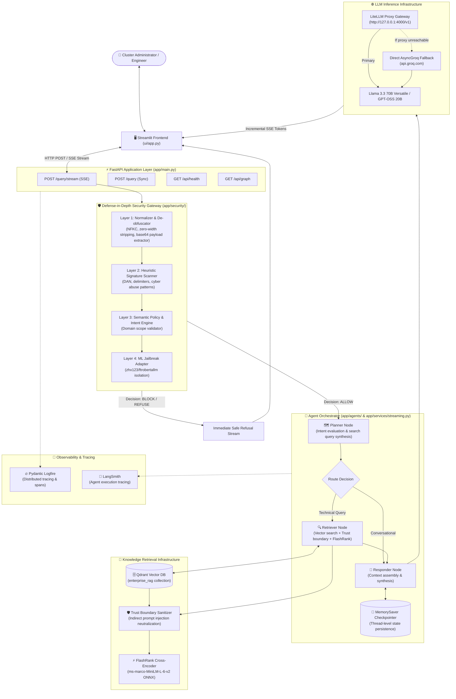

# System Overview & Architecture

## 1. Executive Summary

The **Enterprise Kubernetes Agentic RAG Platform** is an enterprise-grade technical assistant engineered for Kubernetes administration, cluster operations, and defensive security. The platform is designed around five core engineering principles:

1. **Defense-in-Depth AI Security**: Enforcing input normalization, deterministic heuristic pattern recognition, semantic policy boundary enforcement, and context sanitization to prevent prompt injection, jailbreaks, and cyber abuse.
2. **True End-to-End Streaming**: Utilizing Server-Sent Events (SSE) to deliver real-time token streaming directly from model inference down to the user interface with single-generation guarantees.
3. **Agentic Planning & Routing**: Implementing a cyclic state machine powered by LangGraph to distinguish between conversational queries and deep technical queries requiring retrieval.
4. **Hybrid Two-Stage Retrieval**: Combining dense vector similarity search over Qdrant with local Cross-Encoder semantic reranking via FlashRank (`ms-marco-MiniLM-L-6-v2`) on CPU.
5. **Resilient LLM Gateway**: Routing requests through an OpenAI-compatible LiteLLM proxy gateway with seamless failover to direct asynchronous Groq inference.

---

## 2. High-Level Architecture Topology

---

## 3. Component Boundaries and Separation of Concerns

| Component | Directory / Module | Implementation Type | Primary Responsibility |
| :--- | :--- | :--- | :--- |
| **Frontend UI** | `ui/app.py` | Streamlit (Python) | Interactive streaming chat interface, stage indicators, memory controls, expandable retrieved source inspector. |
| **Backend API** | `app/main.py` | FastAPI / Uvicorn | REST & SSE endpoints (`/query/stream`, `/query`, `/api/health`, `/api/graph`), static asset mounts. |
| **Streaming Engine** | `app/services/streaming.py` | Asynchronous Generator | SSE event framing, non-blocking ThreadPool execution of synchronous modules, incremental token yielding, cancellation handling. |
| **Security Gateway** | `app/security/` | Modular Security Pipeline | Multi-layer input evaluation, base64 payload extraction, signature detection, Guardrails AI framework integration, indirect injection scrubbing. |
| **Agent Core** | `app/agents/` | LangGraph StateGraph | Intent evaluation, dynamic query routing, conversational memory state persistence via `MemorySaver`. |
| **Vector Retrieval** | `app/services/retrieval/` | Qdrant Client + FlashRank | Modern `query_points` dense vector search, local ONNX cross-encoder reranking, dual-mode embedding generation. |
| **LLM Gateway** | `app/gateway/`, `litellm/` | LiteLLM Docker Proxy | Unified OpenAI-compatible interface, fallback routes, cache status monitoring, and native Groq SDK fallback. |
| **Document Ingestion** | `app/ingestion/` | Batch Ingestion Processor | Multi-format file parsing (PDF, HTML, DOCX, PPTX, TXT), semantic chunking, local JSON caching, Qdrant indexing. |

---

## 4. Key Design Decisions

1. **Modular Architecture over Distributed Microservices**: The codebase is logically organized into modular packages (`agents`, `gateway`, `ingestion`, `security`, `services`) running inside a cohesive Python application. This minimizes operational complexity while maintaining clean separation of concerns.
2. **Single LLM Call in Streaming Pipeline**: In `app/services/streaming.py`, the final synthesis step uses an asynchronous streaming client directly, bypassing double-execution of the responder node while preserving full LangGraph planning and retrieval.
3. **Local CPU Reranking**: FlashRank runs in-process using quantized ONNX models, providing cross-encoder semantic precision without introducing external API network round-trips or GPU dependencies.
4. **Fail-Safe Security Boundaries**: When external ML validators encounter upstream schema issues, the system isolates the error and relies on active regex and semantic policy layers rather than crashing or falsely blocking benign queries.
