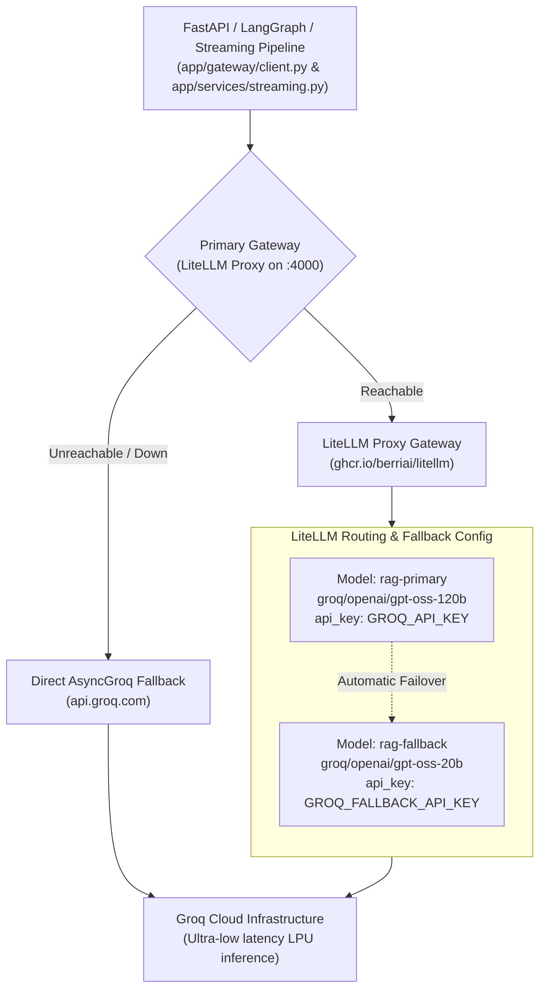

# LLM Gateway & Provider Routing

## 1. Overview & Architecture

The application abstracts LLM inference behind an OpenAI-compatible gateway architecture. This decouples the application logic from specific model providers, allows seamless fallbacks between primary and secondary endpoints, supports centralized prompt caching, and enables audit logging.

---

## 2. Gateway Architecture & Failover Topology



---

## 3. LiteLLM Proxy Configuration (`litellm/config.yaml`)

```yaml
model_list:
  - model_name: rag-primary
    litellm_params:
      model: groq/openai/gpt-oss-120b
      api_key: os.environ/GROQ_API_KEY
      temperature: 0

  - model_name: rag-fallback
    litellm_params:
      model: groq/openai/gpt-oss-20b
      api_key: os.environ/GROQ_FALLBACK_API_KEY
      temperature: 0

litellm_settings:
  num_retries: 2
  request_timeout: 90
  fallbacks:
    - rag-primary:
        - rag-fallback

general_settings:
  master_key: os.environ/LITELLM_MASTER_KEY
```

---

## 4. Application Integration Layers

### A. LangChain / LangGraph Adapter (`app/gateway/client.py`)
Provides `get_langchain_llm(feature)` returning an initialized `ChatOpenAI` instance configured with LiteLLM's `base_url` and `api_key`:
```python
def get_langchain_llm(feature: str = "rag") -> ChatOpenAI:
    return ChatOpenAI(
        api_key=settings.LITELLM_MASTER_KEY,
        base_url=settings.LITELLM_BASE_URL,
        model="groq/openai/gpt-oss-20b",
        temperature=0,
        model_kwargs={
            "extra_body": {
                "metadata": {
                    "feature": feature,
                    "_user": "rag-system",
                    "environment": "production"
                }
            }
        }
    )
```

### B. Streaming Pipeline Fallback (`app/services/streaming.py`)
In the streaming path, `_get_async_inference_stream()` handles live token streaming:
1. First attempts `AsyncOpenAI` pointing to `settings.LITELLM_BASE_URL` with a 5.0 second connection timeout.
2. If the proxy is not running or unreachable, catches the exception, logs an informative notice to Logfire, and falls back to `AsyncGroq` using `settings.GROQ_API_KEY`.
3. In both cases, sets `stream=True` and yields incremental delta tokens directly to the client.

### C. Cache Status Inspection
`app/gateway/client.py` provides `extract_cache_status()` to inspect response headers (`x-litellm-cache-status`) and detect whether a prompt was served from the LiteLLM cache (`HIT` vs `MISS`).
