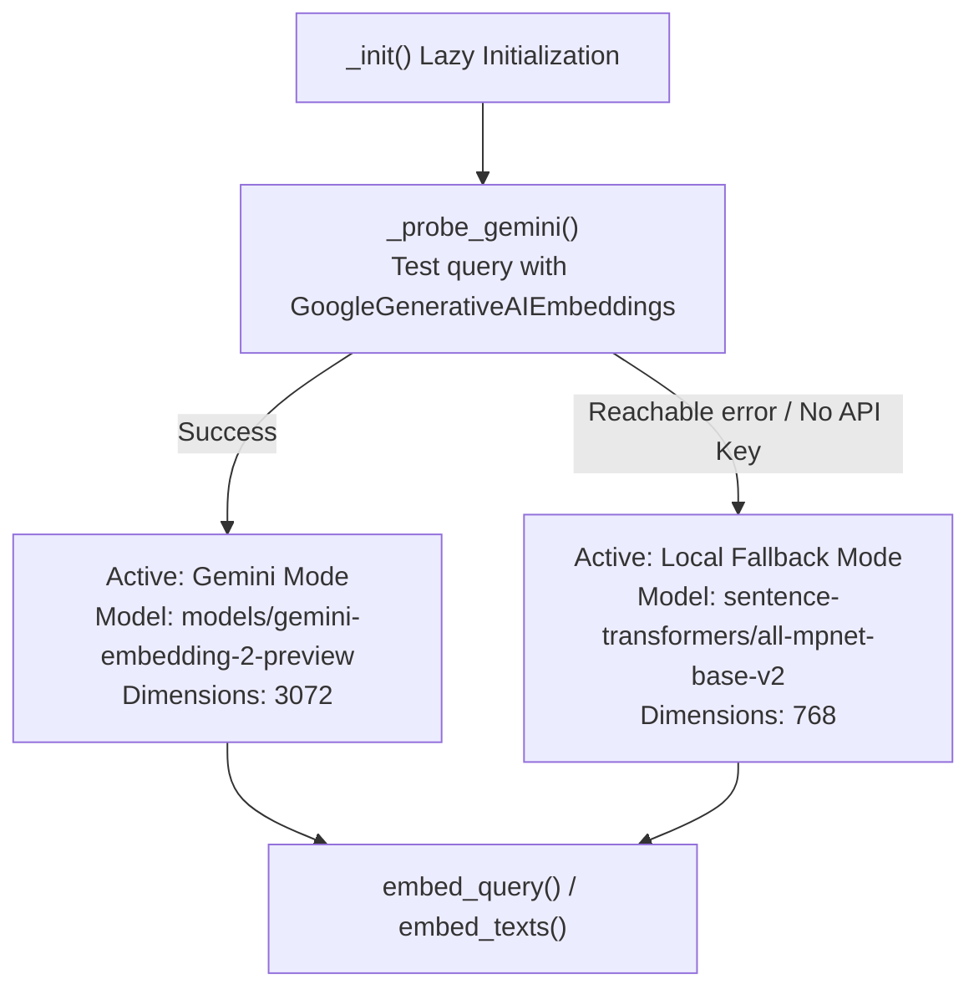

# Embedding Strategy & Dimension Compatibility

## 1. Overview

The embedding subsystem in `app/services/retrieval/embedding.py` provides dense vector representations for both offline document indexing and online query retrieval.

The module incorporates a **dual-mode architecture** with runtime probing, automatic failover, and exponential backoff retry.

---

## 2. Dual-Mode Model Architecture



### Specifications Comparison

| Property | Primary Mode (Gemini) | Fallback Mode (Local SentenceTransformers) |
| :--- | :--- | :--- |
| **Model Identifier** | `models/gemini-embedding-2-preview` | `sentence-transformers/all-mpnet-base-v2` |
| **Embedding Dimension** | `3072` | `768` |
| **Runtime Location** | Google AI Cloud API | Local in-process CPU |
| **API Key Required** | Yes (`GEMINI_API_KEY`) | No (100% offline) |
| **Rate Limit Resilience** | Exponential backoff (1s → 2s → 4s → 8s) | Not applicable |
| **Primary Use Case** | Cloud deployment & high semantic resolution | Air-gapped / local development / quota exhaustion |

---

## 3. Dimension Compatibility & Safety

A vector search failure will occur if documents are indexed at one dimension (e.g. 3072) and queries are embedded at another (e.g. 768).

To prevent dimension mismatches:
1. **Dynamic Dimension Resolution**: `get_embedding_dim()` probes the active model before collection initialization and returns the matching dimension (`3072` or `768`).
2. **Collection Validation**: When `run_universal_ingestion(..., wipe=True)` creates a collection, it configures Qdrant with the vector size returned by `get_embedding_dim()`:
   ```python
   dim = get_embedding_dim()
   qdrant_client.create_collection(
       collection_name=settings.QDRANT_COLLECTION,
       vectors_config=models.VectorParams(size=dim, distance=models.Distance.COSINE)
   )
   ```
3. **Identical Query Pipeline**: Query embedding in `app/services/retrieval/qdrant_service.py` calls `embed_query()`, ensuring query vectors share the exact same active embedding model as document chunks.

---

## 4. Exponential Backoff for Rate Limits

When batch embedding documents with Gemini, API quota limits (HTTP 429) can occur. `_embed_batch()` intercepts rate-limit errors and retries up to 4 times with exponential backoff:
```python
for attempt in range(4):
    try:
        return _active_model.embed_documents(batch)
    except Exception as e:
        if is_rate_limit and attempt < 3:
            wait = 2 ** attempt
            time.sleep(wait)
        else:
            raise
```
