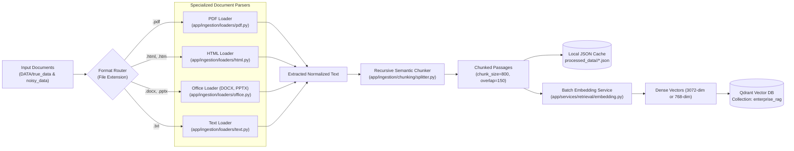

# Knowledge Ingestion & Document Processing Pipeline

## 1. Overview

The ingestion pipeline in `app/ingestion/processor.py` processes technical documentation across multiple formats, decomposes documents into semantic chunks, caches parsed metadata locally, generates dense embeddings, and indexes the vectors in Qdrant.

---

## 2. Ingestion Flow Architecture



---

## 3. Supported File Formats & Loaders

| Format | Extensions | Primary Engine | Fallback Engine |
| :--- | :--- | :--- | :--- |
| **PDF** | `.pdf` | `pypdf.PdfReader` | `pdfplumber` (for complex layout extraction) |
| **HTML** | `.html`, `.htm` | `beautifulsoup4` (`html.parser`) | Strips script/style tags, preserves hierarchy |
| **Word** | `.docx` | `docx.Document` | Paragraph and table text extraction |
| **PowerPoint** | `.pptx` | `pptx.Presentation` | Slide text and shape extraction |
| **Plain Text** | `.txt` | Native Python utf-8 with fallback encodings | Normalizes line endings |

---

## 4. Chunking Strategy

Defined in `app/ingestion/chunking/splitter.py`:
- **Algorithm**: `RecursiveCharacterTextSplitter` from LangChain.
- **Chunk Size**: `800` characters.
- **Chunk Overlap**: `150` characters.
- **Separators**: Priority order `["\n\n", "\n", " ", ""]` to preserve paragraph and sentence integrity.
- **Metadata**: Each chunk retains metadata pointing to its source file name and origin category (`source_type`).

---

## 5. Local JSON Caching (`processed_data/`)

Processed documents are saved locally in `processed_data/<source_type>/<filename>.json`:
```json
{
  "filename": "cronjobs.docx",
  "source_type": "true",
  "chunks": [
    "A CronJob creates Jobs on a repeating schedule...",
    "CronJobs are useful for creating periodic and recurring tasks..."
  ]
}
```
This local cache:
1. Allows offline verification and auditing of extracted text.
2. Prevents re-parsing large documents when re-indexing vector collections.
3. Replaces complex external cloud storage buckets with local persistent artifacts.

---

## 6. Execution Command Reference

```powershell
# Run universal ingestion over all folders in DATA/
python -m app.ingestion.processor DATA

# Wipe the existing Qdrant collection and re-index from scratch
python -m app.ingestion.processor DATA --wipe

# Ingest a specific folder with explicit source type
python -m app.ingestion.processor DATA/true_data true
```
