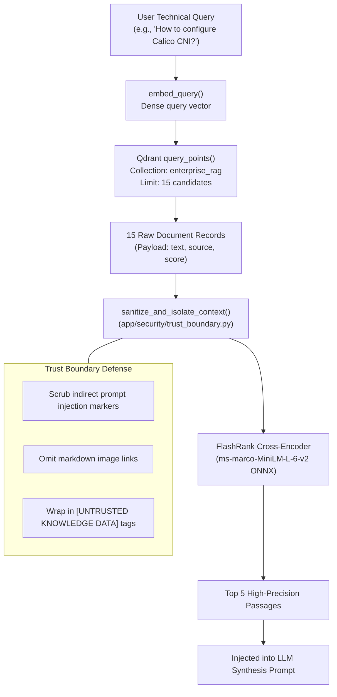

# Retrieval Workflow & Cross-Encoder Reranking

## 1. Overview

Retrieving accurate documentation for Kubernetes architectures requires precision. Standard vector search using cosine similarity excels at broad candidate recall but can surface false positives where document keywords match without addressing the specific architectural question.

The platform addresses this with a **two-stage retrieval pipeline**:
1. **Stage 1 (High Recall)**: Dense vector similarity search in Qdrant retrieving 15 candidates.
2. **Context Sanitization**: Trust boundary isolation to neutralize indirect prompt injection.
3. **Stage 2 (High Precision)**: Local Cross-Encoder semantic reranking via FlashRank filtering candidates down to the top 5 most relevant passages.

---

## 2. Retrieval Lifecycle Flow



---

## 3. Qdrant Integration Details (`app/services/retrieval/qdrant_service.py`)

- **Interface**: Uses Qdrant's modern `query_points` API.
- **Distance Metric**: Cosine Similarity.
- **Collection Name**: Configured via `settings.QDRANT_COLLECTION` (`"enterprise_rag"`).
- **Payload Extraction**: Extracts chunk text, origin source filename, and vector similarity score.

```python
response = client.query_points(
    collection_name=settings.QDRANT_COLLECTION,
    query=query_vector,
    limit=limit,
    with_payload=True
)
```

---

## 4. FlashRank Cross-Encoder Reranking (`app/services/retrieval/ranking_service.py`)

### Why FlashRank?
Standard bi-encoders encode queries and documents separately, calculating cosine similarity between vector dots. Cross-encoders feed the query and candidate passage into the transformer simultaneously with full cross-attention across all tokens.

While traditional cross-encoders are computationally expensive, **FlashRank** executes highly optimized, quantized ONNX weights locally on CPU with minimal latency (~0.05–0.1s for 15 passages):
- **Model**: `ms-marco-MiniLM-L-6-v2` (TinyBERT architecture).
- **Quantization**: INT8 quantized for CPU cache efficiency.
- **Cache Directory**: Uses `/tmp/flashrank` or local user cache.
- **Graceful Degradation**: If FlashRank encounters an exception, it logs an error to Logfire and falls back to original Qdrant cosine ordering without interrupting response generation.
