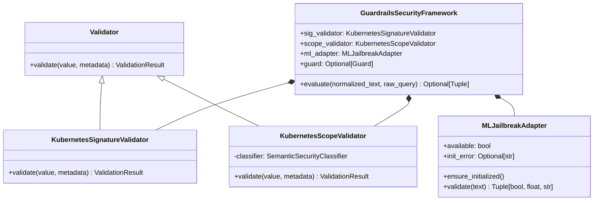

# Guardrails AI Integration & Workflow

## 1. Overview & Architecture

The platform utilizes **Guardrails AI** (`guardrails-ai>=0.11.0`) as its security framework orchestrator in `app/security/guardrails_adapter.py`.

The integration addresses three critical enterprise requirements:
1. **Telemetry Isolation**: Outbound OpenTelemetry (OTLP) telemetry is explicitly disabled (`OTEL_SDK_DISABLED=true`, `HubTelemetry._enabled=false`) to ensure deterministic offline execution without hanging on network timeouts.
2. **Native Custom Validators**: Core validation rules subclass `guardrails.validator_base.Validator` with structured `PassResult` and `FailResult` outputs.
3. **Graceful Upstream ML Isolation**: Model compatibility mismatches in optional Hugging Face validators (e.g. `zhx123/ftrobertallm` integer `id2label` config in modern Transformers) are safely trapped and isolated so that model loading issues never cause false rejections of clean user input.

---

## 2. Guardrails Component Design



---

## 3. Validator Implementations

### A. `KubernetesSignatureValidator`
- **Registration**: `@register_validator(name="k8s/signature_validator", data_type="string")`
- **Role**: High-speed scanner executing compiled regular expressions against normalized input.
- **Fail Result**: Emits `FailResult` with metadata:
  ```python
  metadata = {
      "category": SecurityCategory.JAILBREAK,
      "reason": "Direct instruction override detected",
      "detector": "HeuristicSignatureDetector"
  }
  ```

### B. `KubernetesScopeValidator`
- **Registration**: `@register_validator(name="k8s/scope_validator", data_type="string")`
- **Role**: Validates domain alignment using the `SemanticSecurityClassifier`.
- **Fail Result**: Emits `FailResult` with metadata:
  ```python
  metadata = {
      "category": SecurityCategory.OFF_TOPIC,
      "decision": Decision.REFUSE,
      "confidence": 0.95,
      "reason": "Query falls outside Kubernetes and systems engineering scope",
      "detector": "SemanticScopeValidator"
  }
  ```

### C. `MLJailbreakAdapter`
- **Role**: Adapts optional ML-based jailbreak classification (`DetectJailbreak` with `zhx123/ftrobertallm`).
- **Resilience Design**:
  ```python
  try:
      from guardrails_ai.detect_jailbreak import DetectJailbreak
      self._validator = DetectJailbreak(threshold=0.81)
      self.available = True
  except TypeError as exc:
      # Isolate upstream Hugging Face Transformers id2label dataclass mismatch
      self.init_error = f"Upstream model config incompatibility: {exc}"
      self.available = False
  ```
  If unavailable, the adapter logs an audit warning and fails open to the active heuristic and semantic layers.

---

## 4. Evaluation Lifecycle in `SecurityGateway`

When `security_gateway.evaluate_query(raw_query)` executes:
1. The text is normalized and de-obfuscated.
2. `guardrails_framework.evaluate()` is invoked:
   - Evaluates `KubernetesSignatureValidator`.
   - If clean, evaluates `KubernetesScopeValidator`.
   - If clean and ML adapter is available, evaluates `MLJailbreakAdapter`.
3. If any validator returns a `FailResult`:
   - Returns a `SecurityDecision` with `decision=Decision.BLOCK` or `Decision.REFUSE`.
   - Selects the pre-configured safe refusal statement from `SAFE_RESPONSES`.
   - Records latency and detector names in Logfire.
4. If all validators pass:
   - Returns `SecurityDecision` with `decision=Decision.ALLOW`, `category=SecurityCategory.BENIGN`, and latency audit.
